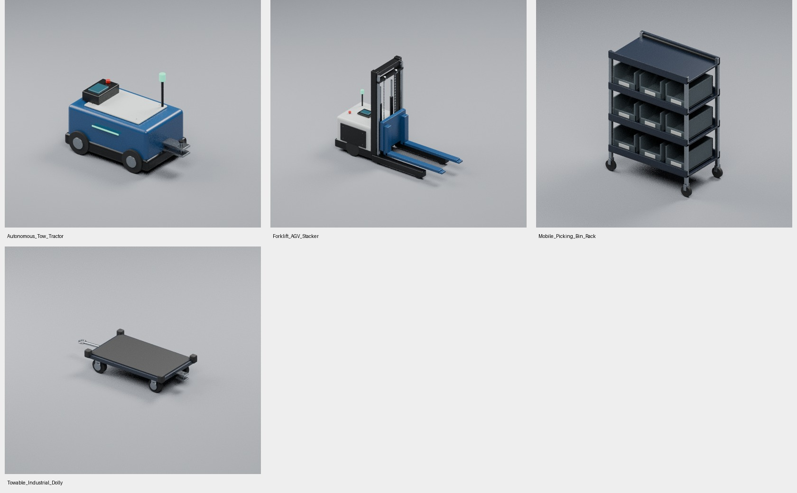
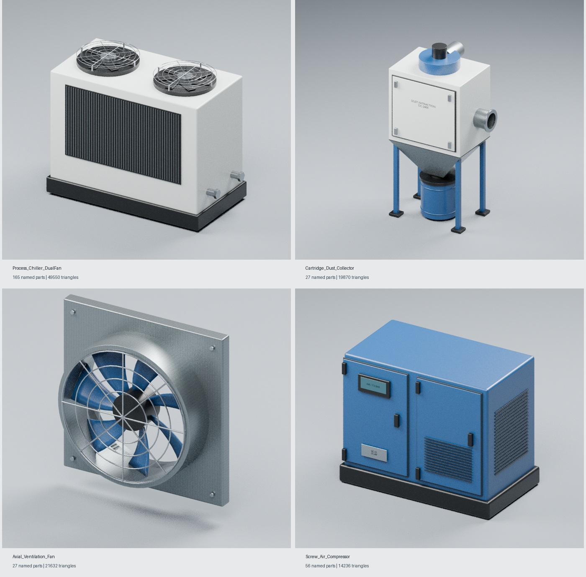
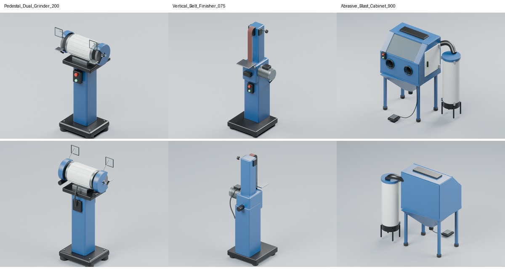
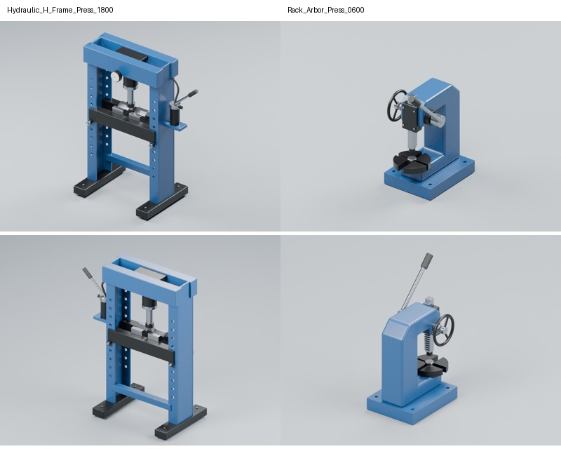
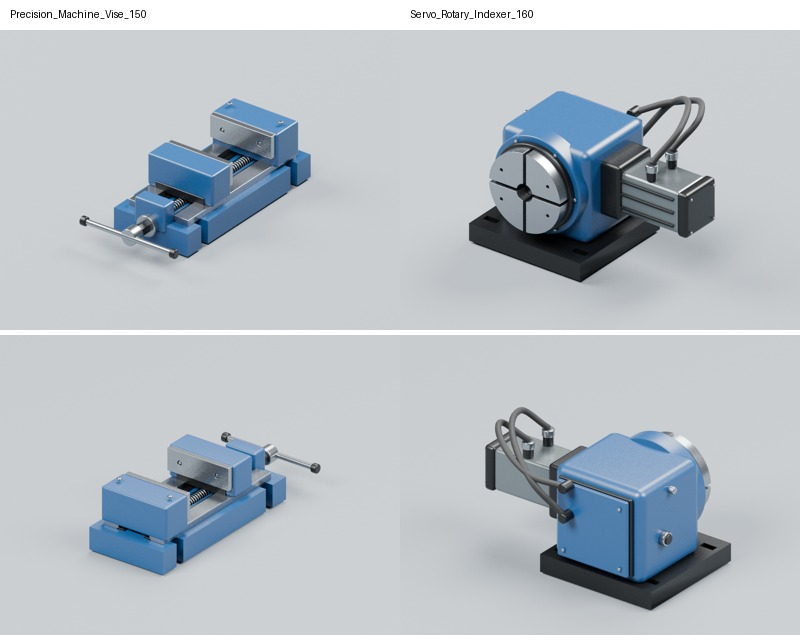
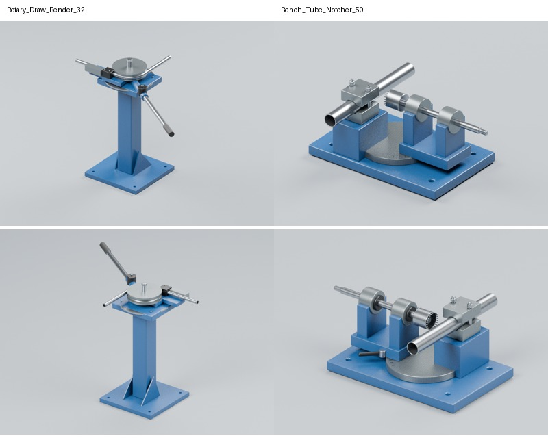

# 工业场景 3D 资产库

面向工厂布局、产线演示与工业场景可视化的分类资产。包含机械臂、AMR / AGV、输送设备、机加工设备、仓储、电气安全及厂务配套。

**当前已发布：74 项独立资产 · 13 个完整 ZIP · Blender 源文件 + GLB + 材质贴图。** 统计按独立资产计数，不将同一模型的不同视角、格式或旧修订重复计入。更新日期：2026-11-14。

> 当前定位为偏写实的场景级资产，适合中距离布局展示。不是照片级扫描资产、精确制造 CAD 或可直接运行的设备仿真。下面均为实际模型渲染图，不是外部参考照片；最终显示受查看器灯光与色彩管理影响。


## 下载

前往 **[v1.0.0 下载页](https://github.com/pbsmart/industrial-3d-assets/releases/tag/v1.0.0)**，展开 **Assets**，选择下列编号 ZIP。每包可独立解压，不是分卷压缩。

| 包 | 分类与代表内容 | 独立资产数 |
|---|---|---:|
| [01_Robotics_Conveying.zip](https://github.com/pbsmart/industrial-3d-assets/releases/download/v1.0.0/01_Robotics_Conveying.zip) | 紧凑型 AMR、六轴机械臂、皮带输送机 | 3 |
| [02_Machining_Inspection.zip](https://github.com/pbsmart/industrial-3d-assets/releases/download/v1.0.0/02_Machining_Inspection.zip) | CNC 铣床/车床、工作台、视觉检测、三坐标、钻床、带锯 | 7 |
| [03_Forming_Packaging.zip](https://github.com/pbsmart/industrial-3d-assets/releases/download/v1.0.0/03_Forming_Packaging.zip) | 折弯机、激光切割机、缠绕包装机 | 3 |
| [04_Warehouse_Logistics.zip](https://github.com/pbsmart/industrial-3d-assets/releases/download/v1.0.0/04_Warehouse_Logistics.zip) | 货架、托盘、周转箱、搬运车、分拣输送、AGV 及充电座 | 16 |
| [05_Electrical_Safety.zip](https://github.com/pbsmart/industrial-3d-assets/releases/download/v1.0.0/05_Electrical_Safety.zip) | 电控柜、围栏、安全门、操作台、信号灯、接线箱 | 6 |
| [06_Plant_Utilities.zip](https://github.com/pbsmart/industrial-3d-assets/releases/download/v1.0.0/06_Plant_Utilities.zip) | 泵组、储气罐、空压机、冷水机、除尘器、风机、管线桥架等 | 10 |
| [07_Additional_10_Assets.zip](https://github.com/pbsmart/industrial-3d-assets/releases/download/v1.0.0/07_Additional_10_Assets.zip) | 末端夹具与焊接单元 3 项、厂务模块 3 项、输送装卸模块 4 项 | 10 |
| [08_Finishing_Process_Pressing_Welding_9_Assets.zip](https://github.com/pbsmart/industrial-3d-assets/releases/download/v1.0.0/08_Finishing_Process_Pressing_Welding_9_Assets.zip) | 表面处理 3 项、清洗/送料 2 项、压力设备 2 项、焊接定位 2 项 | 9 |
| [09_Workholding_2_Assets.zip](https://github.com/pbsmart/industrial-3d-assets/releases/download/v1.0.0/09_Workholding_2_Assets.zip) | 精密机用虎钳、伺服分度台 | 2 |
| [10_Bulk_Mixing_2_Assets.zip](https://github.com/pbsmart/industrial-3d-assets/releases/download/v1.0.0/10_Bulk_Mixing_2_Assets.zip) | 螺旋计量料斗、升降搅拌机 | 2 |
| [11_Sheet_Forming_2_Assets.zip](https://github.com/pbsmart/industrial-3d-assets/releases/download/v1.0.0/11_Sheet_Forming_2_Assets.zip) | 手动卷板机、立式压筋机 | 2 |
| [12_Tube_Fabrication_2_Assets.zip](https://github.com/pbsmart/industrial-3d-assets/releases/download/v1.0.0/12_Tube_Fabrication_2_Assets.zip) | 台式管材开槽机、旋转拉弯机 | 2 |
| [13_Maintenance_2_Assets.zip](https://github.com/pbsmart/industrial-3d-assets/releases/download/v1.0.0/13_Maintenance_2_Assets.zip) | 优化版工业吸尘机（74,008 三角面）、气管卷盘 | 2 |
| **合计** | **不含未发布的制作中资产** | **74** |

**不要把 GitHub 自动生成的 `Source code (zip)` 当作完整模型包。** 仓库正文用于说明和预览，大型模型在 Release 附件中。仓库当前为公开，编号资产包可通过 Release 下载。

## 文件与材质

各交付包保留资产源文件、导出模型、贴图与预览，具体目录以包内说明为准：

- **`.blend`**：继续编辑网格、对象层级、材质及预览场景的 Blender 源文件。
- **`.glb`**：glTF 2.0 二进制模型，供支持 glTF 的查看器/引擎导入；导出纹理嵌入文件。
- **PNG 材质贴图**：保留外部贴图副本，便于重新绑定、调整或转换。材质采用 PBR 工作流；使用程序化生成的微表面纹理，不是实物扫描材质。
- **预览与说明**：实际渲染图、资产说明或检查记录；部分包另外保留制作脚本。

源文件打包图像，GLB 保留 UV 和嵌入纹理。不同资产的通道、分辨率及内部结构存在差异，不宣称每个材质都具有同一套独立通道图。原始微纹理主要为 512 / 1024 像素，近距离特写仍需进一步精修。

## 分类预览

以下为部分代表资产的多方向预览，不等于全部 74 项的完整清单。点击图片可查看大图。

### 机加工与检测


### 成形、切割与包装


### AGV 与仓储物流


### 电气与安全


### 厂务设备


### 末端夹具与焊接单元


### 输送与装卸模块


### 表面处理


### 清洗与送料


### 压力设备


### 焊接定位


### 工件夹持


### 散料与搅拌


### 钣金成形


### 管材加工


### 维护设备
该批次的实际渲染预览随第 13 包提供。

吸尘机采用经过外观核查的软管几何优化版，74,008 三角面；不含被淘汰的激进减面实验，不代表自动 LOD 或浏览器性能保证。

## 使用建议

1. 下载编号 ZIP 并完整解压；需要继续精修时打开 `.blend`，需要在场景引擎中使用时导入 `.glb`。首次打开源文件时无需运行附带脚本。
2. 按米制尺度搭建场景，并根据包内说明和实际导入包围盒复核比例。设备名称中的数字是资产标识或名义规格，不代替工程尺寸图。
3. 在 GLB 查看器中配置环境光、主光与合适曝光。Blender 的摄影棚灯光、世界环境和色彩管理不能假定完整随 GLB 传递；不打光时金属可能显得很暗。
4. 大量实例化时关注纹理内存、网格数量及透明材质开销；建议按视距制作 LOD、合批或实例化，而不是直接假定适合所有手机和 Web 场景。
5. 仓库以保留可编辑源文件和可复用导出为目标。修改前另存副本，避免覆盖原始资产。

## 已做检查与边界

- 交付流程包含 GLB 重新导入、UV/嵌入图像检查和实际渲染检查；ZIP 完整性与上传附件校验值已核对。未进行所有引擎、所有硬件的兼容性认证。
- 主要为**静态展示资产**，不承诺随包包含动画、碰撞体、物理仿真或生产逻辑。
- 六轴机械臂具有 J1 → J6 刚体层级并做过小角度单轴姿态测试；**没有完整 IK、关节限位、软管变形或全运动范围碰撞验证**。
- 设备采用通用工业造型，不是特定厂商型号的精确复刻。标牌中的电压、防护等级、容积等只是可视化文字，不表示真实认证或性能。
- 适用于方案沟通、工业场景搭建与演示，不用于加工制造、施工、安全校核或设备采购依据。

## 项目结构

```text
README.md       项目说明、下载入口与使用边界
previews/       实际模型渲染预览
Releases/       GitHub 下载入口，不是仓库内目录
  v1.0.0        编号资产 ZIP 和校验附件
```

本仓库当前为公开。后续批次只有实际完成上传后才纳入已发布数量；不要将制作计划当作已交付资产。
